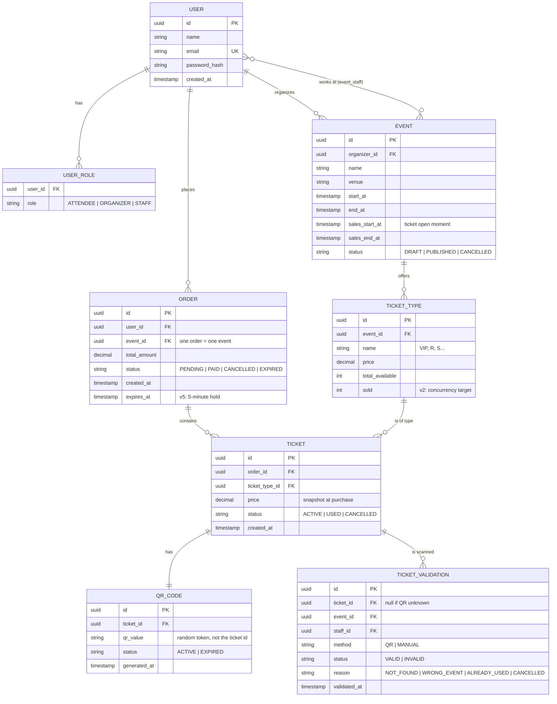

# TicketRush — Design

A concert / event ticketing platform built to survive **ticket open (티켓 오픈)**:
the moment thousands of people try to buy a few hundred tickets at the same time.

This file is a living document. When the design changes, update it here first, then write code.

---

## 1. Actors (who uses the system)

| Role | What they do |
|------|--------------|
| **ATTENDEE** | Browses events, buys tickets, sees "my tickets" + QR code |
| **ORGANIZER** | Creates and publishes events, defines ticket types, sees sales |
| **STAFF** | Works at an event, scans QR codes at the gate |

One `User` can have **several roles** (an organizer can also attend other events).
So we use **roles**, not inheritance (one class extending another).

---

## 2. Data model (v1)

Changes from the first sketch:
- Organizer / Staff / Attendee → one `User` + `user_roles`
- `Ticket Sale` → `Order` (주문). Payment comes in v5.
- Event dates → `startAt`, `endAt`, `salesStartAt`, `salesEndAt` + `status`
- Money → `BigDecimal` (never `Double`)
- Staff "works at" Event → join table `event_staff`



### Questions to answer yourself (write answers in NOTES.md)
1. Why does `TICKET` link to `ORDER` and not directly to `USER`?
2. Why store `sold` on `TICKET_TYPE` instead of counting tickets every time? What new problem does it create?
3. Why is `price` a `BigDecimal`? Why also copy `total_amount` into `ORDER`? (Hint: what if the organizer changes the price tomorrow?)
4. `TICKET_VALIDATION` is a separate table, not a `boolean used` on `TICKET`. Why?

---

## 3. Architecture (v1)

Start simple: **one Spring Boot app + one PostgreSQL**. A "modular monolith"
(one app, but code split cleanly by feature) — not microservices yet.

```
[ Browser ]
     │  pages                         │  /api/* (XHR, JWT header)
     ▼                                ▼
┌──────────────────────────────────────────────┐
│  Next.js frontend (port 3000)                │
│  - Server Components render public pages     │──── server fetch ────┐
│  - rewrite /api/* → Spring (same origin)     │                      │
└──────────────────────────────────────────────┘                      │
              │ HTTP + JWT                                            │
              ▼                                                       ▼
┌───────────────────────────────┐
│     TicketRush (Spring Boot)  │
│  user │ event │ order │ ticket│   ← packages by feature
└───────────────────────────────┘
              │ JPA
              ▼
        [ PostgreSQL ]
```

Later versions add: Redis (cache + waiting queue), Kafka, payment provider,
Prometheus/Grafana, AWS. Each one is added only when a real problem asks for it.

---

## 4. Code structure (v1)

```
ticketrush/src/main/java/com/devui/ticketrush/
├── auth/      SecurityConfig, JWT TokenService, signup/login
├── user/      User + roles, /users/me
├── event/     Event, TicketType, public + organizer endpoints, sales report
├── order/     Order, place order (v1: no lock, no payment)
├── ticket/    Ticket, QrCode, my tickets, QR PNG
├── checkin/   TicketValidation, staff gate scan
└── common/    errors (Problem Details), paging, config (Clock, OpenAPI)
src/main/resources/db/migration/V1__init_schema.sql   ← the real schema
```

## 5. Future model additions (not v1)
- v5: `PAYMENT` (id, order_id, provider, amount, status, idempotency_key)
- v8: `VENUE` → `SECTION` → `SEAT`, and `TICKET.seat_id` (seat selection)
